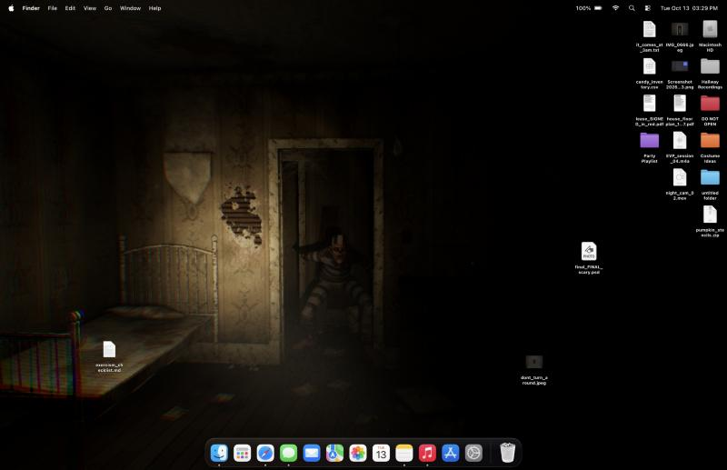

# Haunted Desktop

Your wallpaper is a dark room now. You have a flashlight, a camera and your files. Something lives in the corridor.

It runs in the browser on a fake macOS desktop. The wallpaper is a live three.js scene: a long, abandoned hallway seen
from one end, with doors on both sides into small dark rooms and a tall window at the far end. The only light you have
is a flashlight that points wherever your cursor is; the moon comes in through the side rooms' windows and falls out
of the doorways in pale patches, and now and then lightning shows the whole hallway for an instant. Something moves
from room to room across it. Sometimes it stands in a doorway, or at the far window, until you find it. And sometimes
it comes down the hallway for you, and your light does not stop it.

**Play it: https://deskhaunt.vercel.app**



## Controls

| Input | What it does |
|---|---|
| Mouse | Aim the flashlight |
| Drag a folder onto the floor | It becomes a moving box in the room. Barricade the door. Drop onto a box to stack. |
| Rubber band, Cmd-A, Shift-click | Select many files, as in Finder. Drop a selection into the room and it stacks itself into a wall. |
| Drag a `.usdz` file into the room | Use it: candle, road flare, fresh batteries, music box (see below) |
| Drag a box | Push or carry it (heavy ones only slide) |
| Double-click a box | The file goes back to the desktop |
| Space | Camera flash. The photo lands on your desktop; double-click it to look. |
| F | Flashlight on or off |
| Click anywhere | Turn the sound on |
| N | Sound on or off |
| P | Pause |
| R | Tidy the icons |
| H | Make it come for you now |
| L | Lightning |
| ? | Show or hide the controls legend (top left) |
| 1 to 7 | Make it happen now: cross, wander, dash, crawl, peek, at the far window, hunt (for recording) |

URL options: `?nohud` hides the legend, `?hq` renders at full Retina resolution, `?low` renders below CSS resolution.

## How to survive

Every couple of minutes it comes out of one of the far rooms and down the hallway for you. It walks; in the dark, or
while the old torch flickers, it runs. Now and then the torch dies on its own, and when it comes back on, something is
standing right in front of you. When it sprints across the hallway, lightning usually shows it.

- **Time to build.** While you are dropping and moving boxes, and for 10 s after, it waits in its room (up to ~25 s per
  hunt), and nothing else comes past.
- **Barricade.** Boxes are real rigid bodies. A file's size sets its box's size and mass, from a 1 kg box for a text
  file to an 80 kg one for a disk. It is far stronger than any of them (~3 kN against ~350 N for the heaviest box
  sliding), so a barricade only slows it; it shoves it apart, and boxes wedged where they cannot move (in a door
  frame, say) it tears open: a few blows, depending on how heavy the box is, and it bursts into torn board. The file
  comes back to the desktop, crushed.
- **Flash.** A flash in its face drives it back out. The flash needs four seconds to recharge.
- **Battery.** The menu bar battery is the torch's. Two old alkaline cells: they drain while it burns, sag with
  continuous use, creep back when it rests, and the bulb dims and yellows as they fail (light ∝ V^3.4). The switch has a
  loose contact; a hard shake of the mouse reseats it.
- **Your things.** Folders are moving boxes (their icons are cardboard). The `.usdz` files are what you defend yourself
  with, shown with 3D thumbnails like Finder shows them:
  - `candle`: a 1.5 cd flame. It hates the light and drags itself through its small pool slowly. Burns about two
    minutes; knock it over and it goes out.
  - `road_flare`: red magnesium light for 30 s, bright enough to cast shadows across the hallway. When its light
    reaches it, it shrieks and backs off.
  - `batteries`: fresh cells for the torch.
  - `music_box`: it plays a waltz that runs down. It goes to listen, and then it breaks it.
- **Bait.** A box left by a doorway or in a side room draws it: it comes out for it, carries it off into the dark, and
  leaves you alone for a while. The file comes back later, chewed. Candy works fastest.
- If it reaches you, you will know.

The camera has another use. Take a few photos of the empty room and look at them.

## What it does

- **Flashlight.** A shadow-casting spotlight held a little right of and below your eye, with a reflector beam
  profile (hot centre, ring, dim corona, faint spill). The hand is a damped spring with a little tremor, so the beam
  lags and settles. A second light at the beam's hit point re-emits the light the lit patch reflects, which is what
  dimly fills a real room around a torch beam.
- **Air.** Dust motes only show where the beam crosses them, brightest when they are between you and the light.
  A ray-marched haze pass adds the faint visible cone, with the shadow map so furniture casts shadows into it.
- **The house.** Doors hang on hinges (revolute joints with an old door's stiffness): whatever walks into one swings it,
  and it creaks. Line of sight is a physics ray, so a barricade or a door leaf hides it from your light. The moon is a
  low, cold spot behind every window, each with its own shadow map (redrawn only while something moves).
- **Physics.** Rapier 3D: the walls and big furniture are static colliders, the boxes dynamic bodies with
  cardboard-on-wood friction, and the creature a 75 kg capsule that is only ever moved by forces (2 kN on its way
  somewhere, 650 N when creeping up on you), so walls and furniture stop it and boxes are shoved, not passed through. Your hand is a spring
  with a 380 N limit. Impacts make a thump scaled by the contact force.
- **Photos.** The flash is a short, bright light at the lens. The frame is saved as a JPEG with a date stamp and shown
  in a Quick Look style viewer. What it sometimes shows is posed for that one render only, never the live view.
- **The thing in the corridor.** Seven events: it sprints past, scuttles past on all fours, shuffles past slowly,
  drags itself along the floor, stands in the doorway in the dark, or (rarely) comes into the room. If the beam lands
  on it, it turns to you, screams and runs. Its ground speed comes from each animation's own root motion, so its
  feet do not slide.
- **Sound.** Synthesised with WebAudio, no samples: room tone, settling floorboards, creaking doors, thunder, a sting
  when you catch it, and footsteps panned in 3D and muffled through walls. Each step sounds when one of its feet (or,
  crawling, a hand) goes from swinging to planted on the floor, as loud as the body is moving, so the steps you hear
  always match the ones you see.
- **Camera.** Grain, vignette and a little chromatic aberration at the edges.
- **Laptop friendly.** The beam haze is marched at half resolution. Renders at CSS-pixel resolution, 60 fps while something moves and 30 fps when it is quiet,
  and lowers its own render scale if the GPU takes longer than 7 ms a frame.

## Run it locally

```bash
npm install
npm run dev
```

Then open http://localhost:5175.

## How it's built

- `src/haunt/`: the three.js scene (`scene.js`), flashlight, dust, haze, post-processing, physics and boxes, the
  camera, the creature's events and hunt, and the sound. `layout.js` holds the room's dimensions, and `SPEC.md` the contract the assets follow.
- `src/desktop/`: the fake macOS desktop in plain DOM and CSS, shared with Desktop Roomba.
- `blender/hallway.py` and `hall_tex.py`: build the hallway, side rooms, doors, windows and props procedurally,
  generate every texture with numpy (nothing downloaded), bake ambient occlusion, write the collision boxes and the
  door, room and window markers, and export `public/models/hallway.glb`. `room.py` / `room_tex.py` built the first
  version (a single room) and supply shared textures.
- `blender/mixamo.py`: turns Mixamo FBX downloads into `public/models/creature.glb` and `creature.json`.
- `scripts/fake-desktop.py`: makes the made-up desktop files and renders their real Finder icons.

## Credits and disclaimer

Made by Alan Podemski, built with Claude Code. The creature is the Prisoner B Styperek character with zombie
animations from [Mixamo](https://www.mixamo.com) (Adobe), used under the Mixamo terms. The character and
animations are not covered by this repository's license.

This is a fan project for fun. It is not affiliated with or endorsed by Apple or Adobe. macOS and Apple app icons
are trademarks and property of Apple Inc.

The code is MIT licensed. See [LICENSE](LICENSE).
